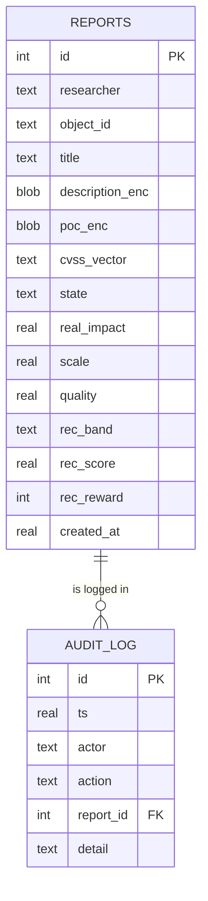
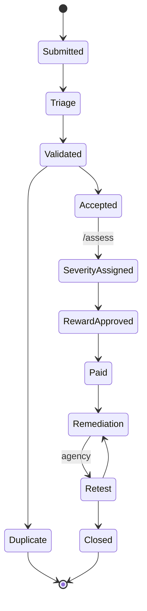

# CyberHunt KZ — research prototype (core slice)

Scope: researcher submits a report -> operator triage -> severity assessment -> reward recommendation
(multi-factor model vs. CVSS-only baseline), with role-based access, encryption of sensitive fields at rest
and an audit log. This is a research prototype, not a production system: tokens are static test tokens, there is
no KYC/2FA, no wallet, no appeals, no duplicate search yet.

## Run
```bash
python -m venv .venv && source .venv/bin/activate
pip install -r requirements.txt
python -m pytest -v                 # tests
uvicorn app.main:app --reload       # API; Swagger UI at http://127.0.0.1:8000/docs
```
Use the header `X-Token` (tokens are in `app/main.py`, e.g. `tok-researcher-1`, `tok-operator`).
Set `CYBERHUNT_KEY` (a Fernet key) to keep encrypted data readable between restarts.

## Data model (ERD)


## Status workflow


## What the tests cover (maps to the report)
| File | Checks | Report objective |
|---|---|---|
| tests/test_cvss.py | CVSS v3.1 calculator against published reference vectors, band boundaries, bad input | O4 (baseline correctness) |
| tests/test_scoring.py | determinism, reward inside published band, monotonic quality, weights sum | O4 (consistency) |
| tests/test_workflow.py | full end-to-end flow, every invalid transition rejected, skipping states, hidden reward | O3 |
| tests/test_access.py | 401/403 cases, researcher isolation, agency per-object access, encryption at rest, audit log | O4 (security) |

## Before you use this as evidence (important)
1. `app/config.json` holds PLACEHOLDER weights and reward amounts. Decide them yourselves, write down the
   justification, and freeze them before any evaluation run.
2. Run the tests and the API on your own machine; take your own screenshots/logs and record versions
   (`python --version`, `pip freeze`) and the commit hash.
3. Known gaps to report as limitations (and fix or list as next steps): static tokens instead of real auth;
   `Accepted -> SeverityAssigned` can also be done by plain /transition, bypassing /assess; no duplicate detection;
   no rate limiting; encryption key handling is minimal; agency access is bound to object ids only.
   Check yourselves whether you find more.
4. Next step for objective O4: write `benchmark.py` that loads your stratified NVD sample (CSV), runs
   `scoring.cvss_only` and `scoring.multifactor` on each record, and saves the comparison. Rules for deriving
   real_impact/scale from record fields must be written down before you run it.
